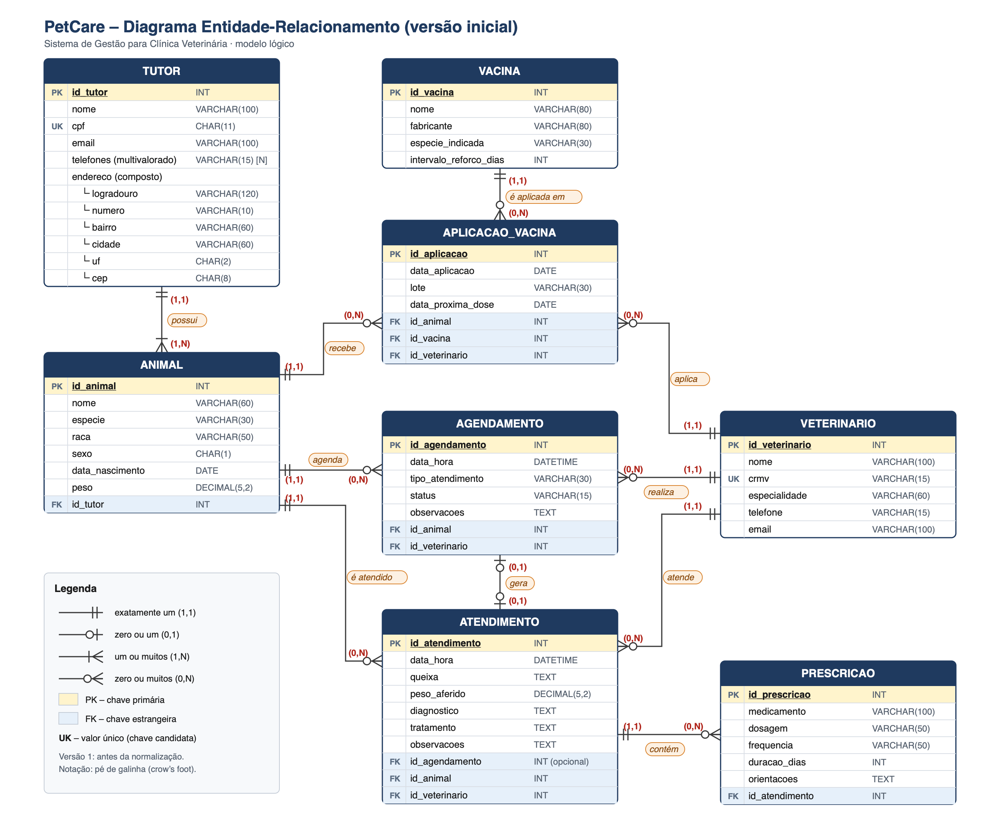
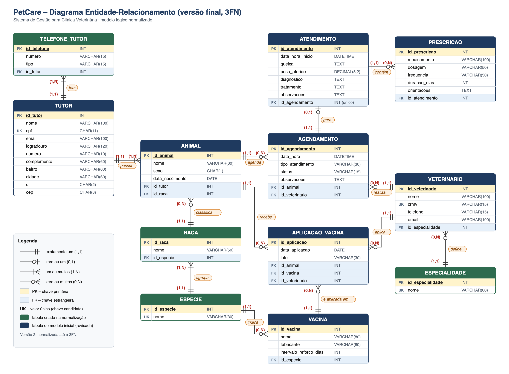

# Experiência Prática II – Diagrama Entidade-Relacionamento

## DER inicial (versão 1)

A primeira versão tem 8 entidades e mantém, de propósito, problemas que seriam corrigidos na normalização:

- `telefones` multivalorado e `endereco` composto em TUTOR (violam a 1FN);
- `especie` e `raca` em texto livre no ANIMAL, onde a raça determina a espécie (viola a 3FN);
- `id_animal` e `id_veterinario` repetidos em ATENDIMENTO, já presentes no AGENDAMENTO;
- atributos derivados: `peso` em ANIMAL e `data_proxima_dose` em APLICACAO_VACINA.

## Relacionamentos (versão 1)

| Relacionamento | Entidades | Cardinalidade |
|---|---|---|
| Possui | Tutor – Animal | 1:N (tutor 1,1 / animal 1,N) |
| Agenda | Animal – Agendamento | 1:N (0,N) |
| Realiza | Veterinário – Agendamento | 1:N (0,N) |
| Gera | Agendamento – Atendimento | 1:1 opcional (0,1 / 0,1) |
| É atendido | Animal – Atendimento | 1:N |
| Atende | Veterinário – Atendimento | 1:N |
| Contém | Atendimento – Prescrição | 1:N (0,N) |
| Recebe | Animal – Aplicação de Vacina | 1:N (0,N) |
| É aplicada em | Vacina – Aplicação de Vacina | 1:N (0,N). Resolve a relação N:M entre Animal e Vacina |
| Aplica | Veterinário – Aplicação de Vacina | 1:N (0,N) |

## DER final (versão 2, normalizado até a 3FN)

As tabelas em verde foram criadas na normalização. O detalhamento de cada forma normal está em [03-normalizacao.md](03-normalizacao.md).

## Suposições de projeto

1. O tutor só é cadastrado com pelo menos um animal e um telefone.
2. Cada animal tem um único tutor responsável.
3. **Todo atendimento tem um agendamento**, inclusive emergências, que geram o agendamento na hora com status "Realizado".
4. Há um veterinário responsável por atendimento e por aplicação de vacina.
5. Cada veterinário tem uma especialidade principal ("Clínica Geral" é o padrão).
6. Animais sem raça definida usam a raça "SRD" da espécie.
7. Cada vacina é indicada para uma espécie.
8. A próxima dose é calculada (data da aplicação + intervalo de reforço).
9. O medicamento é texto, porque o estoque está fora do escopo.
10. Todas as tabelas usam chave substituta `INT`. CPF e CRMV são chaves candidatas (`UNIQUE`).
11. Registros clínicos não são apagados. Agendamentos são cancelados por status.

## Principais desafios

- Definir a relação Agendamento–Atendimento diante de emergências sem marcação.
- Decidir quando um dado vira entidade (espécie, raça, especialidade) ou fica como domínio (`CHECK` em status).
- Perceber a relação N:M entre Animal e Vacina e resolvê-la com uma entidade associativa.
- Equilibrar atributos derivados (peso atual e próxima dose) com a ausência de redundância.
- Decidir se o CEP determina cidade e UF (decisão: não, pois um CEP pode abranger vários logradouros).
