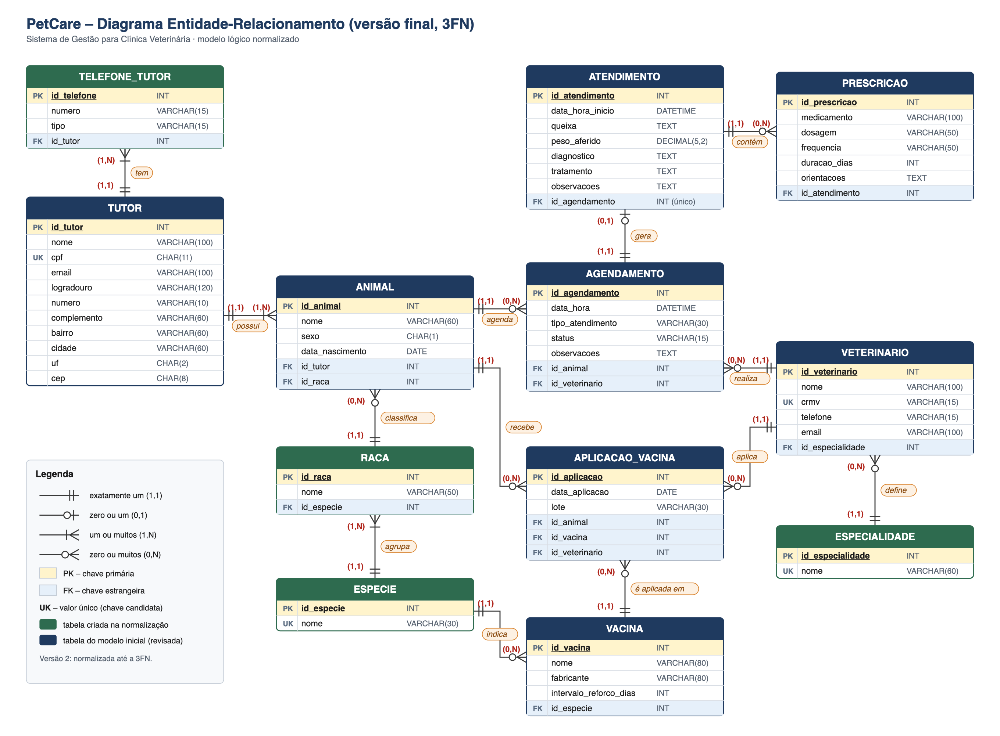

# Experiência Prática III – Normalização (1FN, 2FN e 3FN)

Auditoria do DER inicial em três rodadas, até o projeto lógico final.

## 1FN – Atributos atômicos

**Tabela com desvio:** `TUTOR`.

| Problema | Correção |
|---|---|
| `telefones` multivalorado (vários números na mesma célula) | Nova tabela `TELEFONE_TUTOR (id_telefone, numero, tipo, id_tutor)`, 1:N, com `UNIQUE (id_tutor, numero)` e `ON DELETE CASCADE` |
| `endereco` composto | Colunas atômicas em TUTOR: `logradouro`, `numero`, `complemento`, `bairro`, `cidade`, `uf`, `cep` |

Descartamos a alternativa `telefone1`, `telefone2` e `telefone3`, que criaria um grupo repetitivo.

## 2FN – Dependência funcional total

Todas as tabelas usam chave primária simples (`INT AUTO_INCREMENT`), então **não há dependências parciais**. Analisamos os cenários em que uma chave composta seria natural:

- **APLICACAO_VACINA** com chave `(id_animal, id_vacina, data_aplicacao)`: dados da vacina dependeriam só de `id_vacina`. Eles ficam isolados em VACINA, e a tabela usa `id_aplicacao` com `UNIQUE (id_animal, id_vacina, data_aplicacao)`.
- **TELEFONE_TUTOR** `(id_tutor, numero)` e **PRESCRICAO** `(id_atendimento, medicamento)`: os atributos não-chave dependem da chave completa.

## 3FN – Dependências transitivas

| Tabela | Infração | Solução |
|---|---|---|
| ANIMAL | `id_animal → raca → especie` | Novas tabelas `ESPECIE` e `RACA`. ANIMAL guarda só `id_raca` |
| ANIMAL | `peso` derivado do histórico | Removido. O peso atual vem do último `atendimento.peso_aferido` |
| VETERINARIO | `especialidade` em texto livre | Nova tabela `ESPECIALIDADE`. FK `id_especialidade` |
| VACINA | `especie_indicada` em texto | FK `id_especie` para ESPECIE |
| ATENDIMENTO | `id_atendimento → id_agendamento → id_animal, id_veterinario` | Agendamento obrigatório. ATENDIMENTO guarda só `id_agendamento` (`NOT NULL UNIQUE`) |
| APLICACAO_VACINA | `data_proxima_dose` derivada | Removida. É calculada na consulta |

**Decisões mantidas:** o endereço permanece em TUTOR (o CEP não determina cidade e UF de forma confiável). `status` e `tipo_atendimento` são domínios fechados com `CHECK`.

## Modelo final (12 tabelas)

```
ESPECIE          (id_especie PK, nome UK)
RACA             (id_raca PK, nome, id_especie FK)
ESPECIALIDADE    (id_especialidade PK, nome UK)
TUTOR            (id_tutor PK, nome, cpf UK, email, logradouro, numero, complemento, bairro, cidade, uf, cep)
TELEFONE_TUTOR   (id_telefone PK, numero, tipo, id_tutor FK)
ANIMAL           (id_animal PK, nome, sexo, data_nascimento, id_tutor FK, id_raca FK)
VETERINARIO      (id_veterinario PK, nome, crmv UK, telefone, email, id_especialidade FK)
VACINA           (id_vacina PK, nome, fabricante, intervalo_reforco_dias, id_especie FK)
AGENDAMENTO      (id_agendamento PK, data_hora, tipo_atendimento, status, observacoes, id_animal FK, id_veterinario FK)
ATENDIMENTO      (id_atendimento PK, data_hora_inicio, queixa, peso_aferido, diagnostico, tratamento, observacoes, id_agendamento FK UK)
PRESCRICAO       (id_prescricao PK, medicamento, dosagem, frequencia, duracao_dias, orientacoes, id_atendimento FK)
APLICACAO_VACINA (id_aplicacao PK, data_aplicacao, lote, id_animal FK, id_vacina FK, id_veterinario FK)
```


